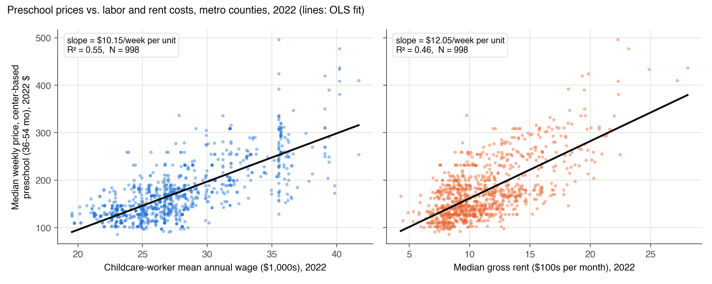
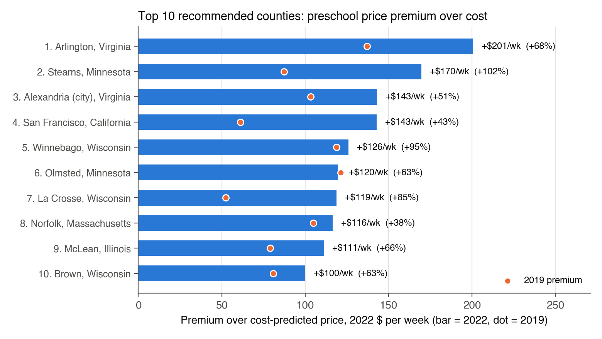
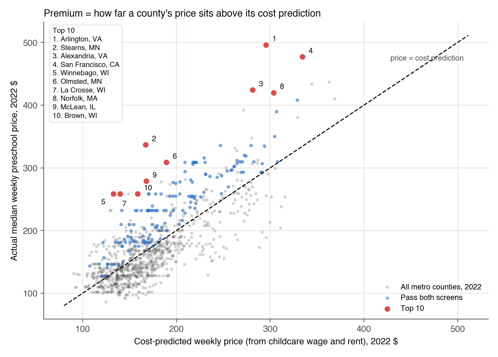
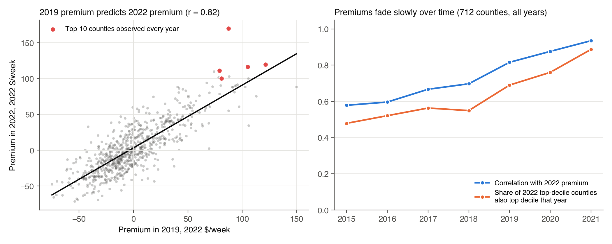

**Purpose of this document.** This is the analysis behind our final presentation (slides to follow): the
pre-analysis of prices and costs, the county recommendation with its methodology and reliability checks, and an
appendix of data-handling decisions. All code, data and the prompt history are in the project repository,
<https://github.com/ignaciosanur/mgt403-childcare-project-green-cohort-7b> (`final_analysis.py`).

**Data.** Metro counties only (counties in an OEWS metropolitan area, `oews_area` begins with `00`), 2015–2022.
*Price:* NDCP median weekly full-time price of **center-based preschool care (36–54 months)**. *Costs:* BLS OEWS mean
annual wage of childcare workers (SOC 39-9011), which is published per metro area, and ACS median gross rent per
county. *Demand:* ACS 5-year county covariates. All dollar values are in constant 2022 dollars (CPI-U). The county is
the unit of analysis throughout.

# Summary: our top 10

We define an attractive market as a county where preschool prices are **high relative to what labor and rent costs
predict**. We estimate a cost model of prices on childcare wages and rent, measure each county's **premium** (actual
price minus cost-predicted price), keep counties with a large enough market and a premium that has been positive
since 2019, and rank them by their 2022 premium.

| # | County | Metro area | Price (\$/wk) | Cost-predicted (\$/wk) | Premium (\$/wk) | Confidence |
|---|---|---|---|---|---|---|
| 1 | Arlington County, VA | Washington-Arlington-Alexandria | 496 | 296 | **+201** (+68%) | High |
| 2 | Stearns County, MN | St. Cloud | 337 | 167 | **+170** (+102%) | Verify: price trend |
| 3 | Alexandria city, VA | Washington-Arlington-Alexandria | 424 | 281 | **+143** (+51%) | High |
| 4 | San Francisco County, CA | San Francisco-Oakland-Hayward | 477 | 334 | **+143** (+43%) | High |
| 5 | Winnebago County, WI | Oshkosh-Neenah | 259 | 133 | **+126** (+95%) | Verify: regional price |
| 6 | Olmsted County, MN | Rochester | 309 | 189 | **+120** (+63%) | Verify: regional price |
| 7 | La Crosse County, WI | La Crosse-Onalaska | 259 | 140 | **+119** (+85%) | Verify: regional price |
| 8 | Norfolk County, MA | Boston-Cambridge-Nashua | 420 | 304 | **+116** (+38%) | High |
| 9 | McLean County, IL | Bloomington | 279 | 168 | **+111** (+66%) | Verify: price trend |
| 10 | Brown County, WI | Green Bay | 259 | 159 | **+100** (+63%) | Verify: regional price |

The top 10 charge on average \$352 a week against a cost prediction of \$217, a premium of about **\$135 a week per
preschooler**. **Confidence:** four picks (Arlington, Alexandria, San Francisco, Norfolk) pass every data check.
Four (the three Wisconsin counties and Olmsted, MN) report a *regional* price shared with 7–8 other counties in their
state. Two (Stearns, MN and McLean, IL) rest on a 2018–2022 price rise above the 99th percentile of metro counties
(+77% and +59% vs. a median of +11%), which NDCP partly extends by straight-line interpolation between surveys.
These six should be confirmed with local price data; section (b) gives a fully high-confidence alternative list.

# Part A. Pre-analysis: prices and costs

## A1. Analysis dataset

We merged the NDCP prices onto the year × county cost and demand file from Problem Set 5 (on county FIPS × year).
The analysis dataset contains the **metro county-years with a non-missing preschool price and non-missing values
for all predictors** (childcare wage, rent, and the eight ACS variables).

| Year | 2015 | 2016 | 2017 | 2018 | 2019 | 2020 | 2021 | 2022 |
|---|---|---|---|---|---|---|---|---|
| Counties in the analysis dataset | 994 | 1,019 | 1,057 | 1,062 | 1,061 | 1,050 | 905 | 998 |

In 2022, of 1,235 metro counties, 222 have no NDCP price (mainly whole states without usable price surveys:
Pennsylvania, Indiana, Missouri, New Mexico, Arkansas and Puerto Rico) and 15 have a price but a missing predictor
(no OEWS wage, or Connecticut's 2022 ACS geography change), leaving **998 counties**.

## A2. Analysis sample, 2022

| Variable (metro counties, 2022) | N | Mean | SD | Min | Max |
|---|---|---|---|---|---|
| Median weekly price, center-based preschool (36–54 months) | 998 | \$174.48 | \$59.76 | \$86.19 | \$496.30 |
| Childcare-worker mean annual wage | 998 | \$27,780 | \$4,351 | \$19,540 | \$41,700 |
| Median gross rent, per month | 998 | \$1,106 | \$336 | \$430 | \$2,805 |
| Per-capita income | 998 | \$37,859 | \$9,457 | \$16,368 | \$89,702 |
| Total population | 998 | 255,803 | 551,110 | 50 | 9,936,690 |
| Own children under 6 | 998 | 17,151 | 37,250 | 0 | 616,046 |
| Children under 6 with all parents in the labor force | 998 | 11,538 | 24,539 | 0 | 406,465 |
| Share of women 25+ with a bachelor's degree or higher | 998 | 30.6% | 11.1 pp | 8.1% | 77.6% |
| Share of women 16–64 working full-time, year-round | 998 | 44.6% | 5.6 pp | 21.2% | 71.4% |
| Share of the population under 6 | 998 | 6.4% | 1.1 pp | 0.0% | 10.9% |
| Share of the population under 6 with all parents working | 998 | 4.3% | 0.9 pp | 0.0% | 7.0% |

## A3. Prices against wages and rents

Both costs line up strongly with prices: counties where childcare workers earn more and where rents are higher
charge more for preschool. Wages alone explain 55% of the variation in prices across counties, rent alone 46%. The
spread around each line is wide, though: at a wage of about \$35,000, prices range from about \$130 to almost \$500 a
week. That spread is what our recommendation exploits. The vertical stripes in the wage panel appear because all
counties in a metro area share one OEWS wage.

## A4. Regressions of the 2022 preschool price on wages and rent

Units: price in \$ per week; wage in \$1,000 per year; rent in \$100 per month. Standard errors in parentheses.

| | (a) Wage only | (b) Rent only | (c) Wage and rent |
|---|---|---|---|
| Childcare wage (\$1,000/yr) | **10.15** (0.29) | | **7.09** (0.37) |
| Median gross rent (\$100/month) | | **12.05** (0.41) | **5.91** (0.48) |
| Intercept | −107.59 (8.24) | 41.17 (4.78) | −87.95 (7.83) |
| $R^2$ | 0.547 | 0.460 | 0.608 |
| N (metro counties) | 998 | 998 | 998 |

All slope coefficients are significant far beyond the 5% level ($t$ between 12 and 35).

**Interpretation.**

* **(a) Wage only:** a county whose childcare workers earn \$1,000 more a year charges, on average, **\$10.15 more per
  week** for preschool.
* **(b) Rent only:** a county with \$100 higher monthly median rent charges, on average, **\$12.05 more per week**.
* **(c) Both:** holding rent fixed, \$1,000 more in wages goes with **\$7.09 more per week**; holding wages fixed, \$100
  more in rent goes with **\$5.91 more per week**. Together they explain 61% of price variation.

**Why the coefficients fall in (c).** Wages and rents are strongly correlated across counties ($r = 0.67$):
high-wage metros are also high-rent metros. A one-variable regression therefore gives each cost credit for the
other one too (omitted-variable bias). The bias can be computed exactly. Regressing rent on wages gives a slope of
0.518 (each \$1,000 of wages comes with \$51.8 more monthly rent), so the wage-only slope equals the multivariate
wage effect plus the rent effect it picks up:

$$\hat b_{\text{wage only}} = \hat b_{\text{wage}} + \hat c_{\text{rent}} \times 0.518 = 7.09 + 5.91 \times 0.518 = 10.15.$$

The rent coefficient falls even more (12.05 → 5.91, about half) because the rent-only regression was largely
capturing the wage differences between expensive and cheap metros. Both costs still matter separately, and
regression (c) is the cost model we use to judge whether a county's price is "high given its costs."

# Part B. Final project analysis

## (a) Recommended counties

The bars show each county's 2022 premium in dollars per week (percentage of the cost-predicted price in
parentheses); dots show the same county's premium in 2019. The full list, with characteristics, is in the table in
the Summary.

Every county sits on this chart at its cost-predicted price (horizontal) and actual price (vertical). The dashed
line is "price = cost prediction"; the further above it a county is, the larger its premium. Blue points pass both
screens; red points are the top 10.

**Promising counties beyond the top 10** (ranks 11–20 among screened counties): Ramsey, Anoka, Hennepin, Carver
and Dakota Counties MN (Minneapolis–St. Paul), Trumbull County OH, Howard County MD, Milwaukee and Racine Counties WI,
and Burlington County NJ, all with premiums of \$88–\$100 a week.

## (b) Methodology and reliability

**Step 1: cost model.** For each year 2015–2022 we estimate, across metro counties,

$$\text{price}_i = a + b \times \text{wage}_i + c \times \text{rent}_i + e_i,$$

with real 2022 dollars. The 2022 estimates are regression (c) above.

**Step 2: premium.** A county's premium is its residual, $e_i = \text{price}_i - \widehat{\text{price}}_i$: how much
more (or less) it charges than counties with the same labor and rent costs. A positive premium means families pay
more than costs alone would predict, which is the margin opportunity for a new center.

**Step 3: screens.** Of the 998 counties with 2022 data:

* **Market size:** at least 5,000 children under 6 with all parents in the labor force (the families who need
  full-time care). Below that, a market may not support a new center alongside incumbents. 461 counties pass.
* **Persistence:** a positive premium in every year it is observed from 2019 to 2022, and observed in at least 3 of
  those 4 years.[^persist] 296 counties pass.
* **Both screens:** 155 counties.

**Step 4: ranking.** We rank the 155 counties by their 2022 premium and recommend the top 10.

**Reliability checks.**

| Check | Result | What it means |
|---|---|---|
| Model fit | $R^2$ between 0.56 and 0.67 in every year | Costs explain most, not all, of price differences |
| Coefficient stability | wage slope 6.1–8.2, rent slope 5.7–8.2 (\$/week), 2015–2022 | The cost model is not a one-year artifact |
| Out-of-time prediction | the 2019 premium predicts the 2022 premium with slope 0.88, $R^2 = 0.67$ | Premiums are a persistent market feature |
| Functional form | a log-log model ranks counties almost identically (Spearman 0.98); 8 of our top 10 are in its top 12 | Not sensitive to linear vs. percentage premiums |
| Residual spread | larger residuals at higher predicted prices (Breusch–Pagan $p < 0.001$) | Coefficients stay valid; very high-price counties are less predictable |
| Regional prices | 43% of the variation in premiums is between states; 60% of counties share an exact price with another county in their state | Part of a premium can reflect a state's regional survey rate rather than the county itself |
| Price trends | NDCP fills years between surveys with straight lines (77% of metro counties have exactly linear 2019–2022 prices); 2018–2022 growth median +10.6%, 99th percentile +55.5% | Stearns MN (+77%) and McLean IL (+59%) are extreme; their 2022 premium may partly be an extrapolated trend |

**Robustness list: county-specific prices only.** Several states' price surveys publish regional rates, e.g.
Wisconsin reports 4 distinct prices across its 26 metro counties, Minnesota 7 across 27, Ohio 3 across 38. For a
county with a regional price, the premium partly reflects lower *local* costs measured against a *regional* price.
Restricting the ranking to counties whose price is shared with at most two others in the state gives:

| # | County | Premium (\$/wk) | In main top 10? |
|---|---|---|---|
| 1 | Arlington County, VA | +201 | yes |
| 2 | Stearns County, MN | +170 | yes |
| 3 | Alexandria city, VA | +143 | yes |
| 4 | San Francisco County, CA | +143 | yes |
| 5 | Norfolk County, MA | +116 | yes |
| 6 | McLean County, IL | +111 | yes |
| 7 | Howard County, MD | +89 | new |
| 8 | Burlington County, NJ | +88 | new |
| 9 | DuPage County, IL | +86 | new |
| 10 | Gloucester County, NJ | +85 | new |

Six of the ten survive this check. Adding the price-trend check removes Stearns and McLean as well. **High-confidence
list** (county-specific price and a normal 2018–2022 price trend), ranked by premium: Arlington VA (+\$201),
Alexandria VA (+\$143), San Francisco CA (+\$143), Norfolk MA (+\$116), Howard MD (+\$89), Burlington NJ (+\$88),
DuPage IL (+\$86), Gloucester NJ (+\$85), King WA (+\$83) and Cumberland NJ (+\$80). **Our recommendation:** lead with
the four counties that are in both lists, and treat the other six main picks as candidates to confirm with local
price data before committing capital.

## (c) Market characteristics used to predict promising locations

Our selection rests on four characteristics:

1. **Price premium over costs** (the ranking variable): price relative to what childcare wages and rent predict.
2. **Childcare-worker wages** and 3. **median gross rent**: the two main cost drivers, used to build the cost
   prediction.
4. **Demand depth:** the number of children under 6 whose parents all work (the market-size screen).

Together with the persistence screen, these define our recommendation. The recommended counties also share a
demographic profile:

| Average across counties (2022) | Top 10 | All 155 screened | All 998 metro |
|---|---|---|---|
| Preschool price, \$/week | 352 | 245 | 174 |
| Cost-predicted price, \$/week | 217 | 197 | 174 |
| **Premium, \$/week** | **+135** | +47 | 0 |
| Childcare wage, \$/yr | 31,014 | 29,868 | 27,780 |
| Median gross rent, \$/month | 1,437 | 1,241 | 1,106 |
| Per-capita income, \$ | 55,669 | 44,192 | 37,859 |
| Women 25+ with bachelor's degree or higher | 48.7% | 38.7% | 30.6% |
| Women 16–64 working full-time, year-round | 51.3% | 46.9% | 44.6% |
| Children under 6 with all parents working | 13,740 | 19,952 | 11,538 |
| Share of population under 6 needing care | 4.9% | 4.7% | 4.3% |

Top-10 counties are richer, more educated and have more working mothers. Across all counties, the premium is
modestly higher where income, the female college share and the share of young children needing care are higher.
In a regression of the premium on these demographics, all three are significant at 5% ($t$ = 2.1, 2.6 and 2.3),
but together they explain **only 7%** of the variation in premiums. Demographics help as tie-breakers, but most of
the premium reflects local market conditions (state regulation, competition, the survey's regional rates) that our
data do not observe directly, which is why we rank on the measured premium rather than on demographics.

## (d) Are price premiums stable over time?

**Yes, mostly.** We re-estimated the cost model every year and compared premiums for the 712 counties observed in
all eight years:

* The correlation between a county's premium in a given year and its 2022 premium falls only gradually, from 0.94
  (2021) and 0.82 (2019) to 0.58 (2015).
* Of the counties in the top 10% of premiums in 2022, 89% were also top 10% in 2021, 69% in 2019, and 48% in 2015.
* A county's 2019 premium predicts its 2022 premium with a slope of 0.88: high-premium markets kept about 90% of
  their premium through the pandemic years.
* All ten recommended counties had a positive premium in every observed year from 2019 to 2022, and eight of them
  had a premium of more than \$75 a week already in 2019 (left chart and dots in the bar chart).

**Caveat.** Year-to-year stability is partly mechanical. States run price surveys only every 2–3 years and the NDCP
interpolates between survey years, so adjacent years share data. The comparison over three or more years (2019 or
earlier vs. 2022) is the more honest test, and premiums still persist there.

## (e) What our predictions are missing

1. **Competition and capacity.** We see prices, not supply. A high premium might mean unmet demand (good) or a
   regulated, capacity-constrained market that is hard to enter (licensing waits, staff shortages). Next step:
   number of licensed centers, slots per child, and waitlists by county.
2. **Regulation and staffing ratios.** States with strict staff-to-child ratios or credential rules (Minnesota is
   among the strictest) raise labor cost *per child* beyond the wage level we measure. Part of a Minnesota premium
   may be cost, not margin.
3. **Commercial real estate.** We use residential median gross rent as a proxy; center costs depend on commercial
   lease rates, zoning and outdoor-space requirements.
4. **Missing markets.** The NDCP has no usable 2022 prices for Pennsylvania, Indiana, Missouri, New Mexico, Arkansas
   and Puerto Rico (9.8% of the metro population, including Philadelphia, Pittsburgh, St. Louis, Indianapolis and
   Kansas City), and DC has prices only for 2022. Some of these may be attractive; we cannot rank them.
5. **Price measurement.** NDCP prices are posted median prices from state market-rate surveys, sometimes regional
   rates and interpolated between survey years, not realized prices after discounts or subsidies.
6. **Subsidy exposure.** In markets where many families use CCDF vouchers (\$706/month in 2022, about \$163 a week),
   effective prices are capped by reimbursement rates; this matters less in our high-income top-10 counties.
7. **Demand trends and quality mix.** Birth rates, in-migration of young families, return-to-office patterns, and
   whether the premium reflects higher-quality (accredited) centers that would require matching quality.
8. **Within-county location and the existing footprint** of our own centers and of competitors (e.g. Bright
   Horizons sites already in Arlington or San Francisco).

# Appendix: data-handling decisions

* **Metro sample:** counties whose year-specific `oews_area` begins with `00`, applied as a hard rule. FIPS codes are
  5-character and OEWS areas 7-character strings throughout.
* **Unit of analysis:** the county, including for the OEWS wage, which is published per metro area (every county in
  an area receives that area's wage).
* **Analysis dataset:** county-years with a non-missing preschool price and all predictors (998 counties in 2022).
  Missing values are not imputed.
* **Prices:** NDCP `MCPRESCHOOL`, the median weekly full-time price of center-based preschool care (36–54 months),
  2024 NDCP release. NDCP `_flag` codes mark how age bands were combined, not imputation, so all prices are kept.
* **Wages:** OEWS `A_MEAN` for SOC 39-9011; for 2015–2017 the aggregate-MSA (`aMSA_`) workbook supplies the 11
  largest metro areas, which the MSA file reports only by metropolitan division.
* **Inflation:** CPI-U (CUUR0000SA0) annual averages, verified against the BLS API; real \$ = nominal × CPI₂₀₂₂ /
  CPI_year.
* **Connecticut 2022:** the 2022 ACS reports Connecticut by planning region, so its 7 metro counties have no 2022 ACS
  match and drop out of the 2022 analysis (1.2% of the metro population; not influential).
* **Legacy county codes** 12025 (Dade) and 51515 (Bedford city) are duplicates of current codes and dropped.
* **Ranking parameters:** market-size screen of 5,000 children under 6 with all parents working; persistence over
  2019–2022 counted on observed years (at least 3 of 4); ranking on the 2022 premium in real dollars.
* **Regional prices:** flagged with the number of other metro counties in the same state reporting an identical
  2022 price; a county-specific-price ranking is reported as a robustness check.
* **Price-trend check:** counties whose nominal 2018–2022 price growth exceeds the 99th percentile of metro counties
  (+55.5%) are flagged, because NDCP interpolates linearly between state surveys and an extreme trend may be
  extrapolated. The ranking itself is unchanged; the flag sets the confidence tier.
* **Unweighted:** every county counts equally in the cost model, since counties are the units we choose among.

[^persist]: Some states have no NDCP price in a given year (e.g. Virginia, California, North Carolina and
Pennsylvania in 2021). Counting only observed years avoids excluding a county for missing data rather than for its
premium. DC, which has prices only for 2022, is excluded by the "at least 3 of 4 years" rule, although its 2022
premium (+\$121 a week) would otherwise rank it sixth.
